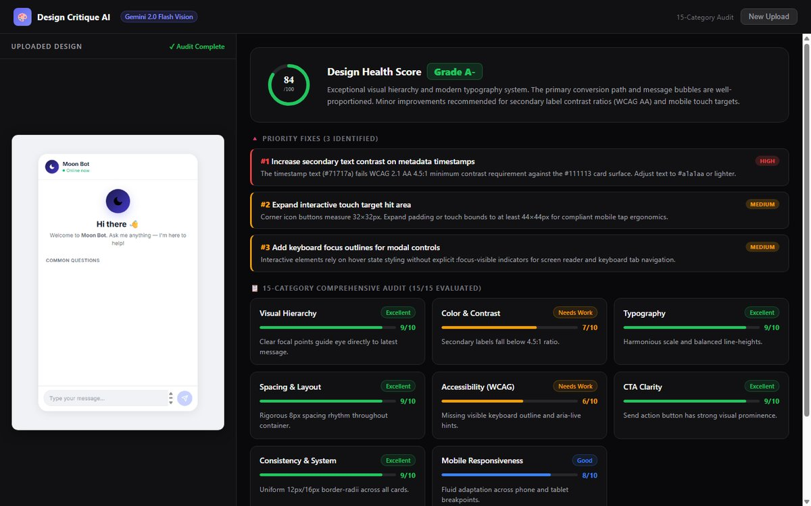
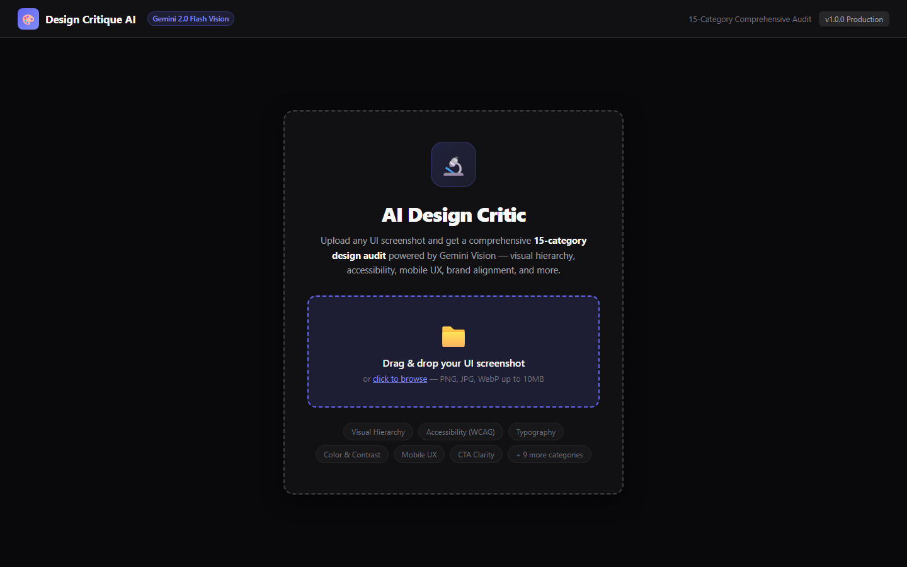
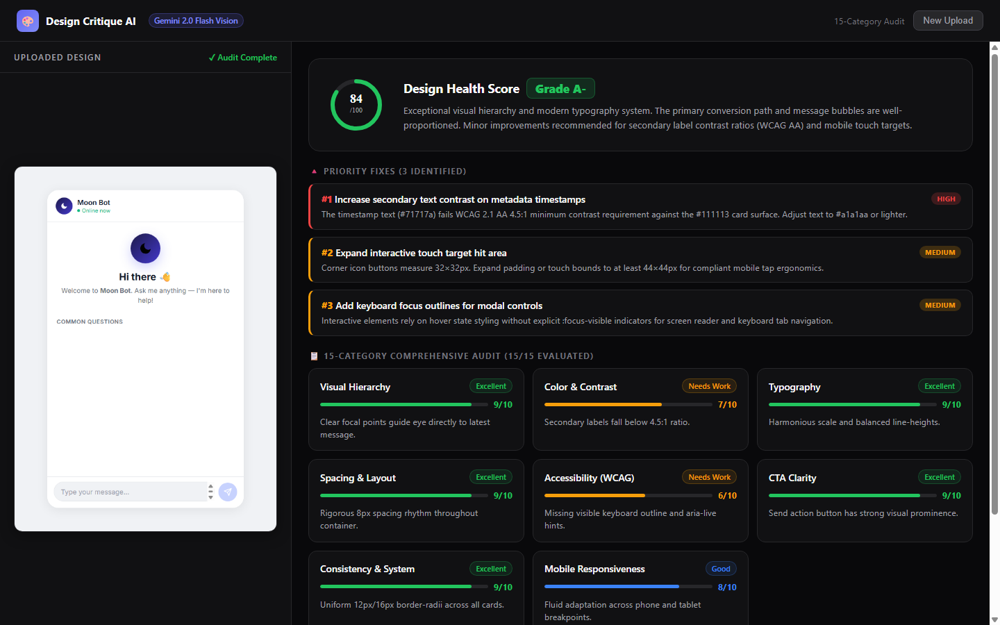

# Design Critique AI 🎨

> **15-Category AI-Powered UI/UX Audit Tool — Gemini 2.0 Flash Vision × FastAPI × React 19**

Upload any UI screenshot and receive a comprehensive, real-time streaming design critique across **15 professional audit categories** — from visual hierarchy and WCAG accessibility to brand alignment and micro-interaction quality.

[](https://python.org)
[](https://fastapi.tiangolo.com)
[](https://ai.google.dev)
[](https://react.dev)
[](LICENSE)

<br/>

<div align="center">



*Figure 1: Authentic Design Critique AI dashboard — uploaded UI screenshot (left) alongside live streaming 15-category critique, health score ring, and priority fixes (right).*

</div>

---

## 🖼️ Interface Walkthrough

<div align="center">

| 1. Drag & Drop Upload Zone | 2. Full 15-Category Audit Dashboard |
|:---:|:---:|
|  |  |
| *Dark-theme upload portal with instant category chips* | *Dual-panel streaming critique & WCAG compliance breakdown* |

</div>

---

## 🔬 What It Does

| Step | Description |
|:--|:--|
| 1 | Drag & drop any UI screenshot (PNG/JPG/WebP) into the dark-theme upload zone |
| 2 | FastAPI backend compresses and sends the image to Gemini 2.0 Flash Vision |
| 3 | Gemini analyzes the design and returns structured JSON critique |
| 4 | Frontend renders categories progressively via real-time **Server-Sent Events (SSE)** |
| 5 | View overall score, grade, per-category breakdown, priority fixes, and highlights |

---

## 📋 15 Audit Categories

| # | Category | What's Evaluated |
|:--|:--|:--|
| 1 | **Visual Hierarchy** | Z-pattern, F-pattern, focal points, contrast of importance |
| 2 | **Color & Contrast** | WCAG contrast ratios, color harmony, semantic color use |
| 3 | **Typography** | Type scale, readability, line height, font pairing |
| 4 | **Spacing & Layout** | Grid consistency, whitespace, padding rhythm |
| 5 | **Accessibility (WCAG)** | AA/AAA compliance, alt text, focus states, keyboard nav |
| 6 | **CTA Clarity** | Button visibility, action language, conversion friction |
| 7 | **Navigation & Wayfinding** | IA clarity, breadcrumbs, menu structure |
| 8 | **Consistency & Design System** | Token consistency, component reuse, visual language |
| 9 | **Mobile Responsiveness** | Breakpoint behavior, viewport adaptation |
| 10 | **Touch Target Sizing** | 44×44px minimums, tap target density |
| 11 | **Information Architecture** | Content grouping, cognitive load, data density |
| 12 | **Loading & Empty States** | Skeleton screens, zero-data handling, progress indicators |
| 13 | **Error Handling UX** | Error messaging, recovery paths, inline validation |
| 14 | **Micro-interactions & Feedback** | Hover states, transitions, system feedback signals |
| 15 | **Overall Brand Alignment** | Visual identity cohesion, tone, personality |

---

## 🚀 Tech Stack

| Layer | Technology |
|:--|:--|
| **AI Engine** | Google Gemini 2.0 Flash (Vision multimodal) |
| **Backend** | Python 3.11 · FastAPI · SSE Streaming |
| **Image Processing** | Pillow (resize + compress before Gemini) |
| **Frontend** | React 19 · TypeScript · Vite |
| **Styling** | Pure CSS-in-JS (zero dependency, dark-theme SaaS) |
| **Communication** | Server-Sent Events (SSE) for progressive streaming |

---

## ⚡ Getting Started

### 1. Backend Setup

```bash
cd backend
pip install -r requirements.txt
cp .env.example .env
# Add your GEMINI_API_KEY to .env
uvicorn main:app --reload --port 8000
```

### 2. Frontend Setup

```bash
cd frontend
npm install
npm run dev
# Open http://localhost:5173
```

---

## 🏗️ Project Structure

```
design-critique-ai/
├── backend/
│   ├── main.py              # FastAPI app — SSE streaming endpoint
│   ├── requirements.txt
│   └── .env.example
└── frontend/
    ├── src/
    │   ├── App.tsx           # Two-panel layout orchestration
    │   ├── types.ts          # TypeScript interfaces
    │   └── components/
    │       ├── Header.tsx         # Top bar with branding
    │       ├── UploadZone.tsx     # Drag & drop image upload
    │       ├── ImagePreview.tsx   # Left panel — uploaded image + status
    │       └── AnalysisPanel.tsx  # Right panel — streaming critique cards
    ├── index.html
    ├── vite.config.ts
    └── package.json
```

---

## 🔒 Security & Privacy

- Images are processed **in-memory only** — never persisted to disk or database.
- `GEMINI_API_KEY` is stored server-side only — never exposed to the browser bundle.
- Input size limit: **10MB** per image.
- Image resized to max **1920×1920px** before API call to minimize latency and cost.

---

## 👨‍💻 Author

**Obaidhur Rahaman** — Full Stack Developer · UI/UX Designer · AI Engineer  
[Portfolio](https://rahaman1721.framer.website) · [GitHub](https://github.com/rahaman1721) · [LinkedIn](https://linkedin.com/in/obaidhur-rahaman-1721z)
